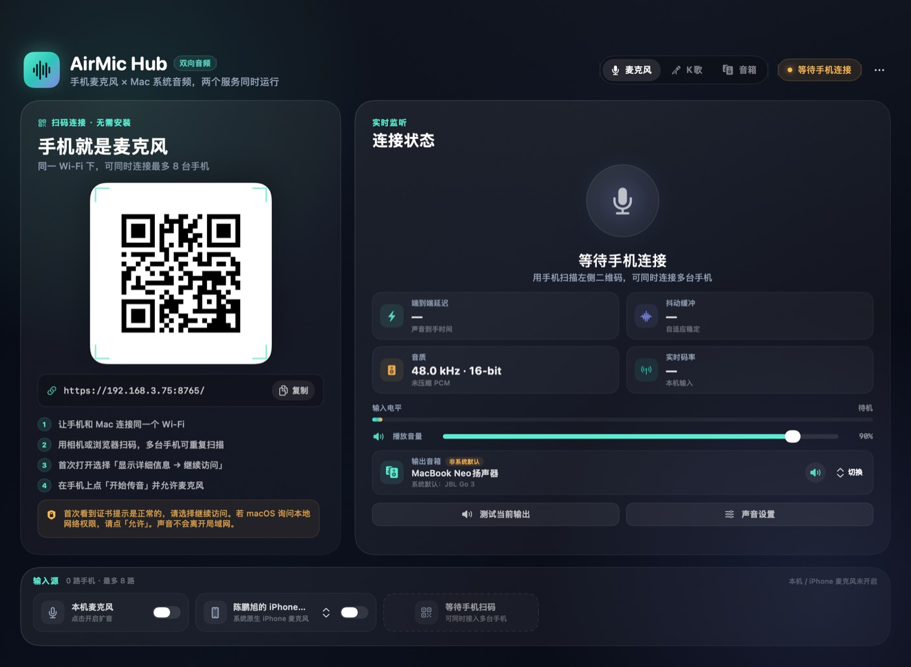
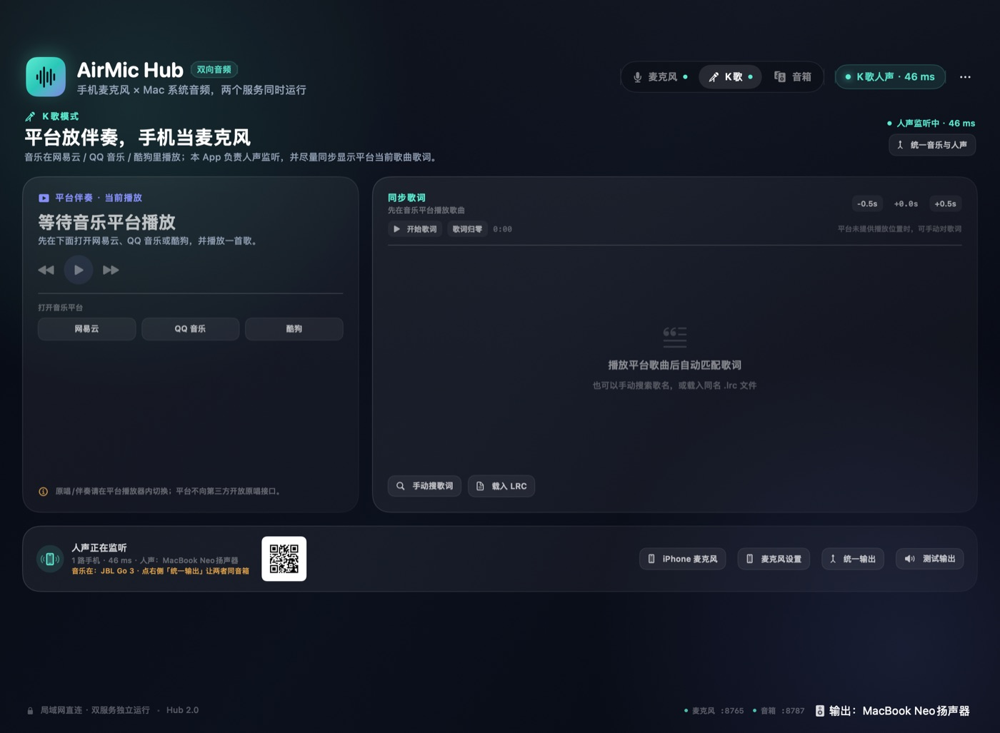
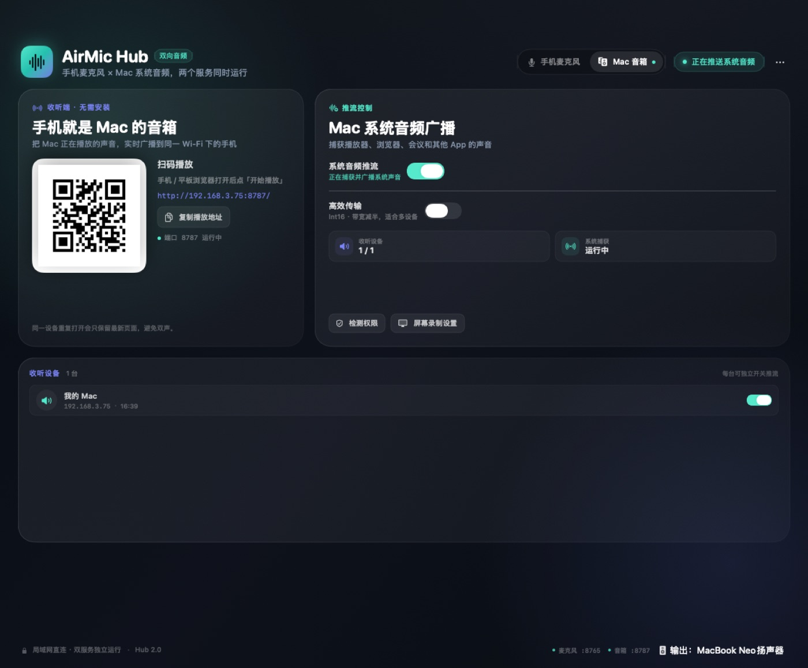
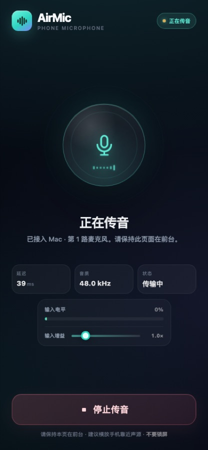
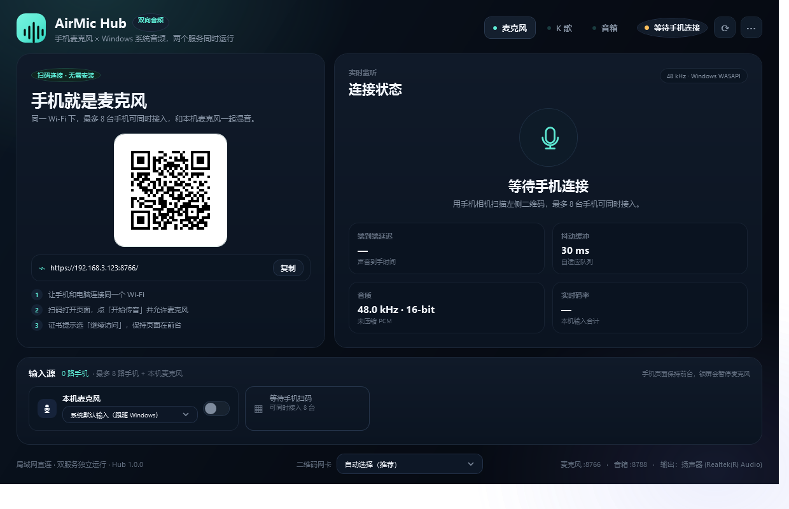
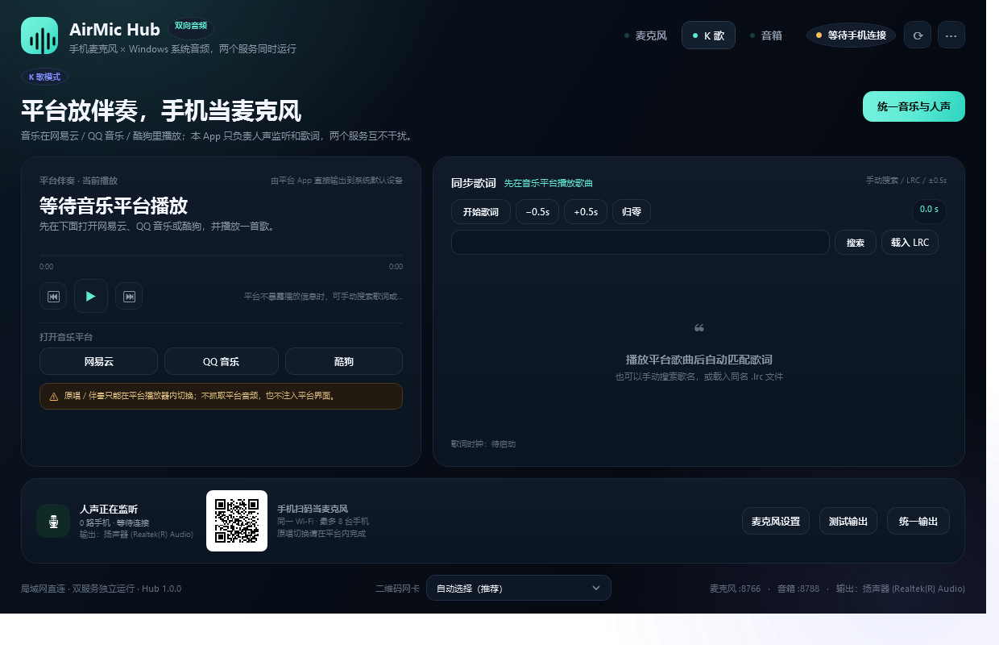

# Mac 音频枢纽 · AirMic Hub

把 **手机变成 Mac 的无线麦克风**，把 **Mac 的系统声音送到手机**，再顺手把 **家庭 K 歌** 做进同一个原生 macOS App。

> 手机麦克风 · Mac 音箱 · K 歌模式 · iPhone 连续互通麦克风  
> 纯局域网、无需安装手机 App、原生 SwiftUI / ScreenCaptureKit / AVAudioEngine。

> **Windows 原生版 1.0.0 已发布**：Windows 10/11 x64，C# / .NET 8 + WPF + Kestrel + NAudio。  
> [下载 Windows 版](#windows-原生版-100) · [Windows 源码](windows/) · [Windows 发布页](https://github.com/cpx734667-netizen/mac-audio-hub/releases/tag/windows-v1.0.0)


<p align="center">
  
  
</p>

<p align="center">
  
  
</p>

---

## 目录

- [它能做什么](#它能做什么)
- [快速开始](#快速开始)
- [Windows 原生版 1.0.0](#windows-原生版-100)
- [使用说明](#使用说明)
  - [手机当麦克风](#1-手机当麦克风)
  - [Mac 声音送到手机](#2-mac-声音送到手机)
  - [K 歌模式](#3-k-歌模式)
  - [iPhone 原生麦克风（实验性）](#4-iphone-原生麦克风实验性)
  - [同时使用 / 多设备](#5-同时使用--多设备)
- [权限说明](#权限说明)
- [延迟与音质](#延迟与音质)
- [常见问题](#常见问题)
- [技术架构](#技术架构)
- [构建](#构建)
- [项目状态与限制](#项目状态与限制)
- [隐私与安全](#隐私与安全)
- [参与贡献](#参与贡献)
- [License](#license)

---

## 它能做什么

### 🎙 手机麦克风

- 手机扫码即用，不需要安装 App；
- 同一 Wi-Fi 下最多 **8 台手机** 同时接入，自动混音；
- 手机端 5 ms 音频帧，服务端自适应缓冲，实测约 **30–50 ms**；
- 支持 Mac 本机麦克风、iPhone 连续互通麦克风与浏览器手机麦克风同时混音；
- 可选择输出音箱、播放测试音。

### 🔊 Mac 音箱

- 用 ScreenCaptureKit 捕获 Mac 正在播放的系统声音；
- 同一 Wi-Fi 下多台手机/平板打开网页即可听；
- 多设备同步保留约 300 ms 目标缓冲；
- 自动排除本 App 自己播放的声音，避免两个功能互相回灌；
- 支持“高效传输”模式，降低带宽占用。

### 🎤 K 歌模式

- 网易云 / QQ 音乐 / 酷狗里直接播放伴奏；
- 本 App 只负责人声低延迟监听，音乐不经过 300 ms 的“Mac 音箱”缓冲；
- 尝试读取系统 Now Playing，自动匹配 LRCLIB 歌词；
- 也可以手动搜歌词、载入本地 `.lrc`；
- 提供歌词时钟和 ±0.5s 偏移，平台不提供播放进度时也能对歌词；
- 一键 **“统一音乐与人声”**：把 macOS 系统输出和 App 人声输出切到同一个内置/有线音箱，避免音乐在 JBL、人声在内置扬声器的错位；
- 平台原唱/伴奏仍需在音乐平台内切换（原因见[项目状态与限制](#项目状态与限制)）。

### 📱 iPhone 原生麦克风（实验性）

- 使用 Apple 官方的 **连续互通相机（Continuity Camera）** 麦克风；
- iPhone 出现在 macOS“声音 → 输入”后，App 会显示独立的 **iPhone 麦克风** 输入源；
- 不走浏览器、不经过 8765 推流，可与浏览器手机麦克风同时使用；
- 使用 AVFoundation 采集，绕过网页端的语音处理链路。

---

## 快速开始

### 直接下载（可选）

**macOS（Apple Silicon）**

[下载 `Mac-Audio-Hub-2.0.0-arm64.zip`](https://github.com/cpx734667-netizen/mac-audio-hub/releases/download/v2.0.0/Mac-Audio-Hub-2.0.0-arm64.zip)，解压后右键 App → **打开**。  
arm64 / ad-hoc 签名，未公证；首次打开可能需要在“系统设置 → 隐私与安全性”里允许。

**Windows（x64）**

[下载 `AirMicHub-win-x64-1.0.0.zip`](https://github.com/cpx734667-netizen/mac-audio-hub/releases/download/windows-v1.0.0/AirMicHub-win-x64-1.0.0.zip)，解压后双击 `AirMicHub.exe`。  
self-contained，无需安装 .NET；首次启动允许防火墙“专用网络”。详见 [Windows 版](#windows-原生版-100)。

### 环境要求

- macOS 14 Sonoma 及以上（开发环境为 macOS 27）；
- Apple Silicon Mac（Intel 未测试）；
- Xcode Command Line Tools：`xcode-select --install`；
- 手机和 Mac 在同一 Wi-Fi / 局域网；
- 不需要 Apple Developer 账号，构建使用 ad-hoc 签名。

### 构建

```bash
git clone https://github.com/cpx734667-netizen/mac-audio-hub.git
cd mac-audio-hub
```

或直接下载：[github.com/cpx734667-netizen/mac-audio-hub](https://github.com/cpx734667-netizen/mac-audio-hub)

```bash
./build.sh            # 构建到 build/Mac 音频枢纽.app
./build.sh --install  # 构建并复制到 ~/Desktop/Mac 音频枢纽.app
```

首次打开：

- 如果 macOS 提示“无法验证开发者”，右键 App → **打开**；
- App 是 ad-hoc 签名，没有公证，这是正常的本地开发构建；
- 端口 `8765`（手机麦克风）和 `8787`（Mac 音箱）会在 App 启动后自动监听。

### 第一次启动建议

1. 打开 App，停在 **手机麦克风** 页；
2. 手机和 Mac 连同一个 Wi-Fi；
3. 手机扫码，首次接受本地自签名 HTTPS 证书；
4. 手机点 **开始传音**，允许麦克风；
5. 在 App 的 **输出音箱** 里选 Mac 内置扬声器或有线音箱；
6. 点 **测试当前输出** 确认能听到声音。

---

## Windows 原生版 1.0.0

Windows 版是独立的原生 .NET 实现，不是把 macOS App 套壳。它复用了浏览器端协议和手机页面，音频栈、证书、设备管理和服务端用 C# 重写。

- **系统要求**：Windows 10 2004+ / Windows 11，x64；self-contained，无需安装 .NET；
- **下载**：[`AirMicHub-win-x64-1.0.0.zip`](https://github.com/cpx734667-netizen/mac-audio-hub/releases/download/windows-v1.0.0/AirMicHub-win-x64-1.0.0.zip)（约 75 MB）；
- **源码**：[`windows/`](windows/) 或 [源码 bundle](https://github.com/cpx734667-netizen/mac-audio-hub/releases/download/windows-v1.0.0/AirMicHub-WindowsPort-1.0.0-github.zip)；
- **发布页**：[windows-v1.0.0](https://github.com/cpx734667-netizen/mac-audio-hub/releases/tag/windows-v1.0.0)；
- SHA256（app zip）：`26cef9c1bcd6ce1ab3ba4b85acffe77ed99c864d34f75c7d4587114ff1f7471a`。

<p align="center">
  
  
</p>

### Windows 快速开始

1. 解压 `AirMicHub-win-x64-1.0.0.zip`，双击 `AirMicHub.exe`；
2. Windows 防火墙弹窗勾选 **专用网络**，允许 `8765` / `8787` 入站；
3. **麦克风** 页：手机扫码 `https://<电脑IP>:8765/`，接受自签名证书，点“开始传音”；
4. 在桌面选择输出设备，点“测试当前输出”确认音箱正确；
5. **音箱** 页：手机扫码 `http://<电脑IP>:8787/`，点“开始播放”；
6. **K 歌** 页：平台放伴奏，人声监听；点“统一音乐与人声”让音乐和人声同音箱。

### Windows 与 macOS 的差异

- **iPhone 连续互通麦克风不支持**：这是 macOS 独占；Windows 版使用普通 Windows 输入设备 + 浏览器手机麦克风；
- **系统声音捕获**：WASAPI loopback / 进程回环，不需要屏幕录制权限；进程回环失败会降级为设备回环，避免回授；
- **原唱/伴奏**：第三方平台没有公开接口，仍只能在平台 App 内切换；
- **8787 的 300 ms 缓冲**：和 macOS 版一致，只适合听歌/看视频，不适合 K 歌实时伴奏；
- **默认输出切换**：使用未公开的 `IPolicyConfig`，失败会提示手动切换，不谎报成功。

### Windows 测试状态

Windows 1.0.0 源码包含 34 个自动化测试（全部通过）和一份 [TEST_REPORT.md](windows/TEST_REPORT.md)。  
测试环境没有实体手机和第三方平台真人 K 歌，因此手机扫码、真实平台播放两项仍需在目标机器上复验；报告里已逐项标注。

更完整的 Windows 说明见 [windows/README.md](windows/README.md)，差异表见 [windows/docs/DIFFERENCES.md](windows/docs/DIFFERENCES.md)。

---

## 使用说明

### 1. 手机当麦克风

1. 打开 App 的 **麦克风** 页；
2. 手机扫描左侧二维码，地址形如 `https://<Mac-IP>:8765/`；
3. 首次打开会看到本地自签名证书警告：
   - iPhone / Safari：**显示详细信息 → 访问此网站**；
   - Android / Chrome：**高级 → 继续前往**；
4. 手机点 **开始传音**，允许麦克风权限；
5. 多台手机重复扫码即可，分别显示第 1、2、3… 路；
6. 需要 Mac 本机扩音时，打开底部 **本机麦克风** 开关；**建议戴耳机，避免啸叫**。

手机端请保持页面在前台，不要锁屏；iOS 锁屏/切后台会暂停麦克风。

### 2. Mac 声音送到手机

1. 切到 **音箱** 页；
2. 首次使用授予 **屏幕录制** 权限；
3. 手机扫描 **音箱** 页二维码，打开 `http://<Mac-IP>:8787/`；
4. 手机点 **开始播放**；
5. Mac 上其他 App 的声音会广播到手机；同一手机重复打开页面只保留最新连接。

**屏幕录制权限说明：**

- macOS 把“捕获系统音频”归在 **屏幕录制** 权限里；本 App 只取声音，不录屏；
- macOS **不会主动弹出屏幕录制授权框**；
- 在 **系统设置 → 隐私与安全性 → 屏幕录制** 中勾选 **Mac 音频枢纽**；
- 如果列表里没有 App，点左下角 **+**，选择 `Mac 音频枢纽.app`；
- 授权后必须 **完全退出并重新打开 App**；
- 使用 ad-hoc 签名时，**每次重新构建/替换 App 都可能重置授权**，需要重新勾选。

### 3. K 歌模式

1. 在网易云、QQ 音乐或酷狗里播放伴奏；
2. App 切到 **K歌** 页；
3. 手机扫码连接麦克风，点 **开始传音**；
4. 点 **“统一音乐与人声”**：
   - 会把 macOS 系统输出和 App 人声输出同时切到内置/有线音箱；
   - 这一步很重要，否则可能出现“音乐在 JBL、人声在内置扬声器”的错位；
5. 歌词：
   - 系统提供 Now Playing 元数据时会尝试自动匹配；
   - 没有自动匹配时，点 **手动搜歌词**，输入歌名/歌手；
   - 或 **载入 LRC**；
   - 点 **开始歌词** 从歌曲开始计时，用 **±0.5s** 校正；
6. 平台原唱/伴奏在音乐平台内切换。

> K 歌时 **不要** 用“Mac 音箱”页给手机转发伴奏：那条链路有约 300 ms 同步缓冲，不适合实时演唱。

### 4. iPhone 原生麦克风（实验性）

这是 Apple 官方的 Continuity Camera 麦克风，不需要浏览器扫码：

1. iPhone 与 Mac 登录同一个 Apple Account；
2. 打开 iPhone 的 Wi-Fi 和蓝牙，解锁并放在 Mac 附近；
3. iPhone：**设置 → 通用 → 隔空播放与连续互通 → 连续互通相机**，确认开启；
4. Mac：**系统设置 → 声音 → 输入**，选择你的 iPhone（类型显示为“连续互通相机”）；
5. 回到 App，等待约 3 秒，**麦克风** 页输入源会出现 **iPhone 麦克风** 卡片；
6. 打开开关；首次会请求 **麦克风** 权限，点允许；
7. 多个 iPhone 时，卡片上的上下箭头可切换；
8. K 歌页底部也有 **iPhone 麦克风** 按钮。

如果 App 中没有出现：

- 点输入源里的 **“添加 iPhone 麦克风”**，会打开系统声音输入设置；
- 先在系统里选中 iPhone，再回到 App；
- 确认 iPhone 已解锁、没有低电量/飞行模式、与 Mac 距离足够近；
- 如果系统“声音 → 输入”里也没有 iPhone，说明 Continuity 设备当前不在线，App 无法凭空创建它。

> 该功能依赖 macOS/iPhone 的 Continuity 状态，标记为实验性。当前版本使用 AVFoundation 采集；如果系统没有暴露设备，界面会提示“未连接”，这是系统状态而不是 App 隐藏。

### 5. 同时使用 / 多设备

两个服务始终同时运行，互不干扰：

- 手机 A 扫码进入麦克风页 → 对 Mac 说话；
- 手机 B 扫码进入音箱页 → 听 Mac 的系统声音；
- Mac 本机麦克风、iPhone 原生麦克风可以和手机麦克风同时混音；
- 二维码可以给不同手机，也可以同一台手机分别打开两个页面。

---

## 权限说明

| 权限 | 用途 | 何时询问 |
|---|---|---|
| **本地网络** | 手机与 Mac 建立局域网连接 | 首次启动 / 首次连接 |
| **麦克风** | 手机传音、Mac 本机扩音、iPhone 原生麦克风 | 手机点开始传音、打开本机/iPhone 麦克风时 |
| **屏幕录制** | 捕获 Mac 系统音频（只取声音，不录屏） | 打开“音箱”页 / 首次播放时 |

### 如果屏幕录制授权一直显示“没有”

这是 macOS 的 TCC 签名机制，不是 App 自己判断错了：

1. 在系统设置中先移除旧的 **Mac 音频枢纽** 条目；
2. 点 **+** 重新添加当前 App；
3. 勾选；
4. 完全退出 App（不是关闭窗口），重新打开；
5. 如果仍不行，点击 App 内的 **重置旧授权**，再添加一次。

使用 ad-hoc 签名时，重新构建会改变代码签名，旧授权记录会失效；这是本项目最容易被误认为“权限坏了”的原因。

---

## 延迟与音质

### 实测延迟

| 链路 | 典型延迟 |
|---|---|
| 手机浏览器麦克风 → Mac 内置扬声器 | **30–50 ms** |
| Mac 本机麦克风 → Mac 内置扬声器 | **25–40 ms** |
| iPhone 连续互通麦克风 | 由 Continuity 决定，通常较稳定 |
| JBL / 蓝牙音箱输出 | +80–200 ms |
| Mac 音箱 → 手机播放 | 约 **300 ms** 目标缓冲 |

### 音质建议

- 手机浏览器链路发送的是 **48 kHz / 16-bit 未压缩 PCM**，码率本身不是瓶颈；
- iOS Safari 可能仍然对麦克风做语音处理（AEC/AGC/降噪），网页无法完全绕过；
- 如果声音“像电话”，优先尝试 **iPhone 原生麦克风**，它绕开浏览器链路；
- 输出优先使用 **Mac 内置扬声器或有线音箱**，不要用蓝牙做 K 歌输出；
- 手机尽量靠近嘴，输入增益不要过高，避免削波；
- 使用 5 GHz Wi-Fi、靠近路由器，减少丢包和抖动；
- K 歌时点 **统一音乐与人声**，保证音乐和人声从同一个音箱出来。

---

## 常见问题

### Q：有杂音 / 断断续续？

先分三路排查：

1. **输出**：切到 Mac 内置扬声器，拔掉耳机/蓝牙，音量 70%，点「测试当前输出」；
2. **输入**：只保留一台手机，关闭本机麦克风，手机输入增益 50%；
3. **8787**：如果只有「Mac 音箱」手机端有杂音，是系统音频捕获链路，不是麦克风。

如果测试音本身也有杂音，优先查耳机口、蓝牙、音量/硬件；如果测试音干净但手机麦克风爆音/断音，通常是 Wi-Fi 抖动或多路叠加。

最新 macOS 构建已加入：局部 5 ms 帧补齐、20/60 ms 抖动缓冲、20 ms 输出目标、软限幅和 DC 阻断。若更新后仍有持续“嘶嘶/电流声”，请把测试音录音发来，判断是底噪还是削波。

1. 看麦克风页的 **输出音箱** 是否选了你正在听的音箱；
2. 点 **测试当前输出**；
3. 检查系统音量、音箱音量、静音键；
4. 如果输出是蓝牙，换内置/有线再试；
5. K 歌时确认点过 **统一音乐与人声**。

### Q：Mac 音箱页显示已连接，但手机没有声音？

1. 确认 **屏幕录制** 权限已授权，并已重启 App；
2. 看 App 里是否显示“正在捕获”；
3. 手机页面是否显示 0 帧/s / 捕获错误；
4. 先播放一段 Mac 上的音乐/视频再打开手机页面；
5. 手机和 Mac 必须能互相访问 8787 端口。

### Q：iPhone 麦克风不出现？

按 [iPhone 原生麦克风](#4-iphone-原生麦克风实验性) 的 1–4 步检查；如果系统“声音 → 输入”里没有 iPhone，App 也无法创建它。

### Q：K 歌歌词不自动滚动？

- 平台没有把 Now Playing 元数据交给 macOS 时，自动匹配会失败；
- 点 **手动搜歌词** 输入歌名/歌手；
- 或载入 `.lrc`；
- 点 **开始歌词** 手动对齐，再用 ±0.5s 校正。

### Q：能切换网易云/QQ/酷狗的原唱吗？

不能。第三方 App 没有公开的播放流/原唱接口；原唱是平台 DRM 音频的一部分，平台不提供开关。请在平台播放器内切换，或使用平台提供的伴唱版本。

### Q：为什么每次重新构建后权限都要重给？

ad-hoc 签名的代码要求会随构建变化，macOS 会把它当成新的 App。发布构建请保持签名稳定，或每次重新授权。

### Q：支持 Intel Mac / Windows / Android？

- macOS 构建为 Apple Silicon（arm64），Intel 未测试；
- **Windows 10/11 x64 有独立原生版**，见 [Windows 原生版](#windows-原生版-100)；
- 手机端只要是现代浏览器即可，Android Chrome 可用。

---

## 技术架构

```
┌──────────────┐    HTTPS/WSS :8765     ┌─────────────────────────────┐
│ 手机浏览器    │ ─────────────────────> │ AirMic 手机麦克风服务        │
│ 5ms PCM 帧   │                        │ 48k 重采样 + 多路混音        │
└──────────────┘                        │        │                    │
                                        │        ▼                    │
┌──────────────┐                        │  AVAudioEngine → 输出音箱     │
│ iPhone 麦克风 │ ── AVFoundation ─────> │                             │
│ Continuity   │                        │                             │
└──────────────┘                        │                             │
                                        │  Mac 本机麦克风              │
                                        └─────────────────────────────┘

┌──────────────┐   ScreenCaptureKit     ┌─────────────────────────────┐
│ Mac 系统声音  │ ─────────────────────> │ Mac 音箱服务 :8787          │
│ 其他 App     │   排除本 App 自身输出   │ HTTP/WS 广播 → 手机播放      │
└──────────────┘                        └─────────────────────────────┘
```

### 端口

- `8765`：手机麦克风，HTTPS + WSS，自签名证书；
- `8787`：Mac 音箱，HTTP + WebSocket；
- 两个服务独立运行，可同时使用。

### 关键实现

- 手机音频：Web Audio `AudioWorklet`，5 ms 帧，Int16 PCM，WSS 传输；
- 服务端：48 kHz 单声道重采样、每路自适应队列、混音；
- 输出：`AVAudioEngine` + `AVAudioPlayerNode`，5 ms 块，目标 15 ms 输出水位；
- Mac 音箱：ScreenCaptureKit 音频捕获，`excludesCurrentProcessAudio = true`；
- K 歌 Now Playing：通过私有 `MediaRemote` 接口读取当前歌曲，使用 LRCLIB 匹配歌词；
- iPhone 原生：AVFoundation `AVCaptureDevice` / `AVCaptureAudioDataOutput`。

### 目录

```
Sources/
  AirMicApp.swift          App 生命周期、可调整窗口
  ContentView.swift        三 Tab 主界面
  AppModel.swift           麦克风/输出设备/输入源状态
  AudioMixer.swift         多路混音与 48k 输出
  HTTPServer.swift         8765 手机麦克风服务
  LocalMicCapture.swift    Mac 默认输入采集
  SystemMicCapture.swift   iPhone Continuity 采集（AVFoundation）
  KaraokeWorkspace.swift   K 歌界面
  LyricsService.swift      LRCLIB / LRC 解析
  NowPlayingService.swift  系统 Now Playing 读取
  SpeakerWorkspace.swift   Mac 音箱界面
  MacSpeaker/              ScreenCaptureKit 捕获与 8787 服务
Resources/
  phone.html               手机麦克风页面
  pcm-worklet.js           手机端 5ms 音频帧
  NowPlayingHelper.m       系统 Now Playing 辅助程序
  Info.plist / 图标资源
docs/
  screenshots/             界面截图
  USAGE.md                 更细的使用步骤
  TROUBLESHOOTING.md       排错手册
  ARCHITECTURE.md          架构说明
windows/                   Windows 原生版（.NET 8 / WPF / Kestrel / NAudio）
  src/                     服务端、音频、UI、歌词
  docs/DIFFERENCES.md      与 macOS 的差异
  README.md                Windows 使用/构建说明
build.sh                   构建/安装脚本
```

---

## 构建

```bash
# 依赖：macOS 14+、Xcode Command Line Tools
xcode-select --install

git clone https://github.com/cpx734667-netizen/mac-audio-hub.git
cd mac-audio-hub
```

或直接下载：[github.com/cpx734667-netizen/mac-audio-hub](https://github.com/cpx734667-netizen/mac-audio-hub)

```bash
./build.sh
open "build/Mac 音频枢纽.app"

# 构建并安装到桌面
./build.sh --install
```

构建产物：

- arm64 App；
- 链接 `ScreenCaptureKit`、`AVFoundation`、`Network`、`CoreAudio`；
- ad-hoc 签名，无公证；
- 不包含任何用户音频、证书私钥或第三方二进制依赖。

---

### Windows 构建

```powershell
cd windows
.\build.ps1
```

要求 .NET SDK 8 + Windows x64。产物在 `windows/dist/`。

---

## 项目状态与限制

这是一个 **可自用的开发预览版**，不是 App Store 产品。macOS 版和 Windows 版是两套原生实现。

### macOS

已验证 / 可用：

- 浏览器手机麦克风，多路混音；
- Mac 本机麦克风扩音；
- Mac 系统声音 → 手机；
- K 歌平台播放 + 人声监听 + 手动歌词/LRC；
- 输出音箱选择与测试音；
- 可调整窗口大小、三 Tab 界面。

实验性 / 有限制：

- **iPhone 原生麦克风**：依赖 macOS Continuity 设备可用性和 AVFoundation；若系统不显示 iPhone，App 无法连接。当前标记实验性，欢迎反馈日志。
- **K 歌自动歌词**：依赖系统 Now Playing 元数据；平台不提供时只能手动搜歌词/LRC。
- **原唱/伴奏切换**：网易云/QQ/酷狗没有公开接口，第三方 App 无法控制；只能在平台内切换。
- **浏览器音质**：iOS Safari 的语音处理可能无法完全关闭；需要更高音质请用 iPhone 原生麦克风。
- **ad-hoc 签名**：重新构建后屏幕录制等 TCC 权限可能重置。
- **Now Playing**：使用 macOS 私有 `MediaRemote` 接口，系统更新可能失效；不打算上架 App Store。
- **Intel Mac**：未测试。

### Windows 1.0.0

已验证 / 可用：

- 手机麦克风 8765 HTTPS/WSS、8 路混音、30 ms 队列上限；
- Windows 系统声音 8787、WASAPI 进程回环/设备回环、排除本应用；
- 三 Tab WPF UI、输出设备选择、测试音、统一输出；
- K 歌 GSMTC/LRCLIB/LRC/歌词时钟；
- 34 个自动化测试通过，self-contained 单文件发布。

实验性 / 限制：

- **实体手机扫码 / 第三方平台真人 K 歌未在开发环境实测**，需目标机复验；
- **iPhone 连续互通麦克风不支持**（macOS 独占）；
- 原唱/伴奏只能在平台内切换；
- Windows 默认输出切换依赖未公开 `IPolicyConfig`，可能失效；
- 进程回环不可用时降级为设备回环，可能捕获本应用监听声；UI/health 会标注。

---

## 隐私与安全

- 音频只在 **局域网** 内传输，不上传云端；
- 手机端使用本地自签名 HTTPS/WSS，首次证书警告是正常的；
- macOS 证书私钥保存在本机 Keychain；Windows 版证书 PFX 使用当前用户 DPAPI 加密，均不写入仓库；
- Mac 系统音频捕获只取声音，不录屏幕，并排除本 App 自身输出；Windows 版使用 WASAPI loopback/进程回环，不录屏；
- K 歌歌词匹配会把 **歌名/歌手/专辑/时长** 发送到 [LRCLIB](https://lrclib.net/) 查询歌词；不使用歌词功能时不会请求；
- 无账号系统、无统计上报、无广告、无遥测；
- 请只播放你有权使用的音乐；本项目与网易云、QQ 音乐、酷狗、Apple 无关联。

---

## 参与贡献

欢迎提交 Issue / PR：

1. Fork 仓库；
2. 创建分支 `feature/xxx`；
3. 提交前运行 `./build.sh` 确认可编译；
4. 提交 PR，说明测试环境（macOS 版本、Mac 型号、iPhone/手机型号）。

请勿在 Issue 中粘贴完整音频、证书私钥或 Apple Account 信息。

---

## License

本项目使用 [MIT License](LICENSE)。

Apple、iPhone、Continuity Camera、ScreenCaptureKit、macOS 是 Apple Inc. 的商标。本项目为独立开源项目，与 Apple 无关联。

---

如果这个项目对你有帮助，欢迎点一个 ⭐。
